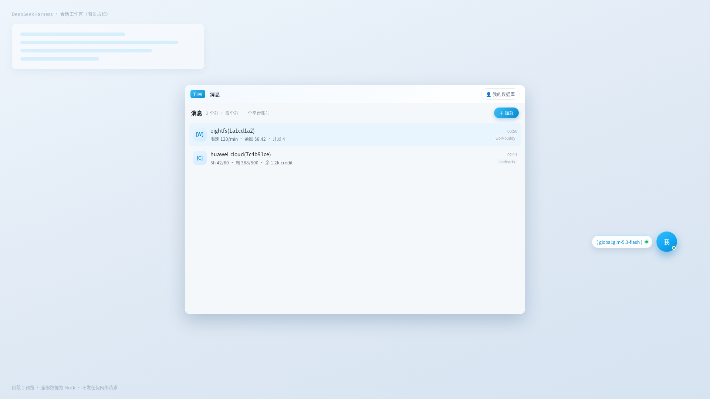
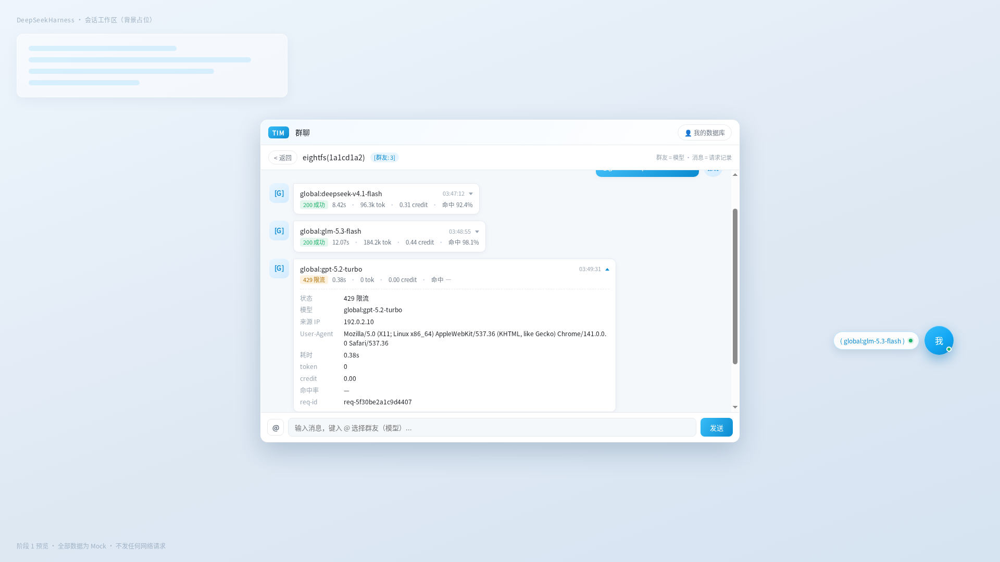

# dsh-model-team

> 把多个模型平台的账号收进一个「群聊」界面管理；对 DSH 只暴露**一个**虚拟模型，按 session 决定真正落到哪个平台、哪个模型。

## 这是什么

DSH 插件。模型选择器里只多出一个「模型团队 · 模型群聊」，真实模型由网关按 session 映射改写后转发。
切换方式：点开右下角悬浮球 → 进群聊 → `@模型名`（或 `@分组名`，由分组按策略轮换）。

## 目标

- DSH 的模型选择器里只多一个条目，不必为每个平台、每个模型各配一次
- 同一个虚拟模型，不同 session 可以落到不同真实模型（可轮转、可回落）
- 账号、群、请求记录都在界面上，不用翻配置文件

## 难点

这几条是真正花时间的地方：

- **LlmAdapter 接缝很窄**：`listModels()` 只能报一个模型；`prepareCall()` / `resolveModel()` 拿不到 session；压缩只看 `requestHeader().config`。结果是容量只能**统一申报**，「按 session 申报窗口」在 0.2.1 里没有信息出口（已独立复核过）
- **sessionId 只有一条来路（已解决）**：服务端 SSE 与 URL 都拿不到，只有客户端槽位 `conversation.input.dock` 能给。已靠它做到「随 UI 切换会话即时跟随、零轮询」
- **上游容量字段不统一**：`context_length` / `max_allowed_size` / `context_window.default` 三种并存，有的干脆不报（本机 agnes 9 个模型 0 个带容量），探测常常一无所获
- **申报窗口同时是压缩门禁的基数**：宿主按 `0.8 × 申报窗口` 触发自动压缩，申报值虚高会把该压的时刻一起推后（见 `docs/10`）

## 理念

- **契约唯一**：`docs/02-契约.md` 冻结端点与字段，其它文档只按节号引用，不复制同一事实
- **机器门禁优先**：端点表 ↔ `routes.js`、DOM 钩子 ↔ `ui/index.html`、层级与显隐 ↔ 样式源码，漂移必须红灯。全部门禁纯 Node 执行，不启浏览器
- **只有最终版**：不留「阶段 N 演示」、不留 mock 传输层；本地预览即真实链路

## 特色

- **群聊式交互**：平台账号 = 群，模型 = 群友，请求记录 = 群友消息，`@` = 切换目标
- **会话级即时跟随**：UI 切会话，悬浮窗与消息记录立刻跟上（客户端槽位桥，零轮询）
- **悬浮球只在该显示时显示**：仅当当前 session 选中本插件虚拟模型时出现；判定依据拿不到时可重试，用尽后判「不可知」并隐藏，不把不属于本插件的入口摆给用户
- **悬浮件状态单一真相**：显隐 / 锚点 / 形态 / 展开方向收在一个状态工厂里，界面不留第二份副本；球与面板整块留在视口内、展开方向按象限自适应
- **图片输入**：申报 `image` 能力，附件按官方 `readImageRequest` 取字节转 `image_url`；能力未加载完、明确不支持、缺附件服务三种情况分别给不同错误，不把图悄悄丢掉
- **主题可替换**：构建期读 `config.theme.html` / `styles`，换主题 = 换一个 HTML；配了但无效直接构建失败，不静默回落默认
- **请求可回溯**：每次调用留一行记录（模型 / 状态 / 速率 / 目标来源），能回答「为什么用了这个模型」
- **零依赖 + 单文件产物**：`lib/client.js` 由分片拼接，受限挂载环境也能跑

## 现状

当前版本 **0.2.9**：文档对齐与资料归档版本；反代完整接入仍未验收。

| 分类 | 内容 |
|---|---|
| 可用 | 加群与账号管理、切换模型、群聊对话、分组（新建 / 编辑 / 删除，含轮换与失败顺延）、通讯录、请求行统计、图片输入、上下文容量申报与超限检查 |
| 自动化 | 用例 + 六道门禁 `gate-all`（构建 / 用例 / 契约 / 渲染 / 样式层 / 代码行），全部纯 Node、无浏览器、无网络 |
| 已知限制 | 子代理继承未做端到端联调（判据已定，见 `docs/06` V-01）；预览环境不提供宿主投影，依赖悬浮球显隐的场景只能在真实宿主验证；主题只在构建期生效 |
| 未做 | 反代 / 本地网关（`docs/11`）、协议 forward/rewrite 双模式（`docs/12`）、压缩接管（已取消，由外部 `dsh-live-compact` 满足，见 `docs/10`） |

## 界面

> 以下为**演示用界面示意图，数据全部是假数据**（Mock），仅用于说明布局与交互，不代表真实账号、真实请求或真实额度。

群列表（平台账号 = 群，右下角为悬浮球）：



群聊（群友消息 = 请求记录，展开一条可看状态 / 耗时 / token / req-id）：



## 文档

从 [docs/00-索引.md](docs/00-索引.md) 进：契约在 `02`，验收在 `04`，已知问题在 `06`，任务清单在 `08`。

## 开发

```bash
node --test test/*.test.js               # 用例
node build.cjs                           # 拼接产物 lib/client.js（勿手改）
node scripts/check-contract.mjs          # 契约门禁：端点表 ↔ 路由、DOM 钩子 ↔ html
node scripts/check-render.mjs            # 渲染门禁：真接口 → render.js → DOM 结构断言
node scripts/check-css.mjs               # 样式层门禁：层级引用与顺序、无魔数、toast 显隐、弹窗遮罩
node scripts/gate-all.mjs                # 提交前手动跑：build/用例/契约/渲染/样式层/代码行 六道
node build.cjs --config <path>           # 换主题：{ "theme": { "html": "...", "styles": ["..."] } }（缺省回落 ui/）
```

## 版本

当前版本见 `package.json`；历史版本由 git tag 承载（`git tag -n1` 可看每条说明），README 不再维护版本表。
